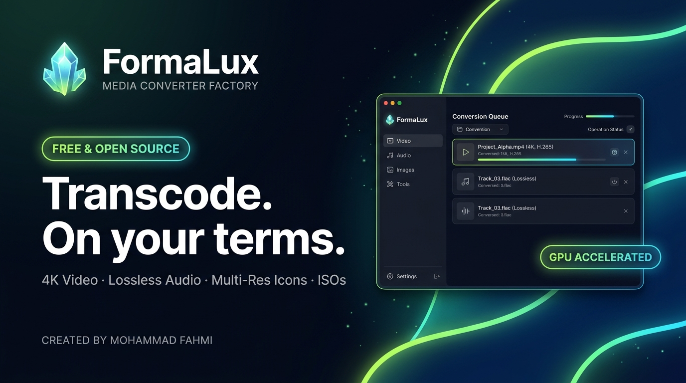
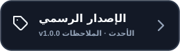
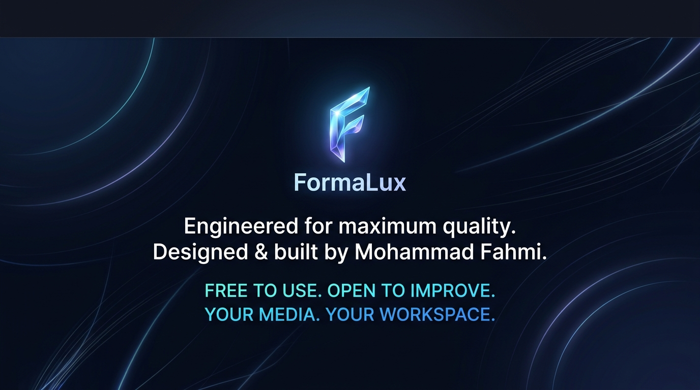

  

<!-- ACTION CTA BUTTONS -->

&nbsp;&nbsp;

&nbsp;&nbsp;

  

<!-- QUICK NAVIGATION -->
**[Engine Studio](#01--high-performance-transcoding-engine)** &nbsp;•&nbsp; 
**[Hardware Acceleration](#-gpu-hardware-transcoding)** &nbsp;•&nbsp; 
**[Subtitle Studio](#-studio-subtitle-burning)** &nbsp;•&nbsp; 
**[Download Specs](#02--official-standalone-package)** &nbsp;•&nbsp; 
**[النسخة العربية](#-النسخة-العربية)**

 

<!-- BADGES BAR -->

 

**Free, open-source, and engineered for uncompromising media quality.**

---

### 🌐 Select Language / اختر لغة العرض
**[🇬🇧 English Documentation](#-english-version)** &nbsp;&nbsp;|&nbsp;&nbsp; **[🇸🇦 الدليل باللغة العربية](#-النسخة-العربية)**

---

 

# 🇬🇧 English Version

## ` 01 ` &nbsp; High-Performance Transcoding Engine ➔
> **PRECISION PROCESSING · LOSSLESS CONVERSION · GPU ACCELERATED**

### Universal Media Studio. Uncompromising Quality.

<table>
<tr>
<td width="33%" valign="top">

### 🎬 `01 / VIDEO & AUDIO`
#### All-in-One Audio-Visual Lab
Transcode 4K Ultra-HD video (`MP4, MKV, WebM, AVI, MOV, TS`), master lossless audio (`FLAC, MP3, WAV, AAC`), boost quiet volume up to 400%, and merge or split clips with millisecond precision.

</td>
<td width="33%" valign="top">

### 🖼️ `02 / GRAPHICS & ICONS`
#### Studio Graphics & Icon Generator
Convert between modern image formats (`WebP, PNG, JPG, BMP, TIFF`) and generate full-scale multi-layer Windows Icon packs (`.ico` from 16px to 256px) with clean transparency.

</td>
<td width="33%" valign="top">

### 💿 `03 / DISCS & UTILITIES`
#### Disc Mastering & Productivity Tools
Rip video DVDs, extract audio CDs to lossless FLAC/MP3, compress ISO disk images to CSO, and manage huge libraries with the integrated batch renamer.

</td>
</tr>
</table>

 

---

### ⚡ GPU Hardware Transcoding
FormaLux automatically queries your graphics hardware to deliver blazing speeds:
* **NVIDIA NVENC:** `h264_nvenc` & `hevc_nvenc` (Ultra-fast 4K export)
* **Intel QuickSync (QSV):** Hardware-accelerated encoding for Intel Iris, Arc, and Core processors.
* **AMD AMF:** Hardware acceleration for AMD Radeon GPUs.

---

### 🖋️ Studio Subtitle Burning
Hardcode subtitles into your movies without any character glitches:
* **Interactive Styling Studio:** Customize font family, color picker, outline border thickness, and drop-shadow depth.
* **Full Arabic Script Support:** Complete native compatibility for **ANSI Windows-1256** and **UTF-8**, rendering connected, properly positioned Arabic subtitles every single time.

 

---

## ` 02 ` &nbsp; Official Standalone Package ➔
> **WINDOWS 64-BIT EDITION · 100% OFFLINE RUNTIME**

### Self-Contained & Production-Ready
FormaLux requires zero external setup. All necessary FFmpeg engines, codecs, and dependencies are securely pre-bundled.

| Technical Specification | Package Details |
| :--- | :--- |
| **Package File** | `FormaLux-Setup.exe` (Signed Installer & Uninstaller) |
| **Download Size** | **~659 MB** (Complete offline bundle — no internet required for transcoding) |
| **Operating System** | Windows 11 / Windows 10 (64-bit) |
| **Update Engine** | Automatic notification & 1-click update via GitHub Releases |
| **Publisher Security** | Verified local publisher certificate & checksum integrity |

 

&nbsp;&nbsp;

 

---

## ` 03 ` &nbsp; Modern Visual Workspace & Native RTL ➔
> **5 LUXURY ACCENT THEMES · FULL ARABIC LOCALIZATION**

FormaLux is crafted with focus on aesthetics and workflow comfort:
* **5 Curated Color Themes:** Dark Obsidian, Deep Navy, Royal Purple, Emerald Green, and Daylight Light.
* **First-Class RTL Localization:** Native Arabic layout engineered with right-to-left perfection alongside English, French, Spanish, and Turkish.
* **Windows Context Menu:** Instant right-click integration to convert any media directly from Windows File Explorer.
* **System Tray Minimization:** Keep long transcoding queues running quietly in the background.

 

---

## ` 04 ` &nbsp; Independent & Open-Source Ecosystem ➔
> **MIT LICENSED · COMMUNITY DRIVEN · CONTINUOUS UPDATES**

FormaLux is an independent, free and open-source project created and actively developed by **Mohammad Fahmi**.

 

<table>
<tr>
<th width="50%">🔍 Resources & Navigation</th>
<th width="50%">🛠️ Developer Hub</th>
</tr>
<tr>
<td valign="top">

* 📦 [Official Release v1.0.0](https://github.com/mohammadfahmi2030/FormaLux/releases/latest)
* 📋 [Changelog & Release Notes](https://github.com/mohammadfahmi2030/FormaLux/releases)
* 🛡️ [License Terms (MIT)](LICENSE)

</td>
<td valign="top">

* 💻 [Clone Repository (`git clone`)](https://github.com/mohammadfahmi2030/FormaLux.git)
* 🐛 [Submit an Issue / Bug Report](https://github.com/mohammadfahmi2030/FormaLux/issues)
* 💡 [Suggest a New Feature](https://github.com/mohammadfahmi2030/FormaLux/issues)

</td>
</tr>
</table>

  

---

 

# 🇸🇦 النسخة العربية (Arabic Version)

<!-- ARABIC ACTION CTA BUTTONS -->

&nbsp;&nbsp;

&nbsp;&nbsp;

  

**برنامج مجاني ومفتوح المصدر، صُمم ليمنحك أعلى جودة ممكنة في معالجة الوسائط.**

 

## ` 01 ` &nbsp; محرك المعالجة والتحويل فائق السرعة ➔
> **دقة متناهية · جودة بدون فقدان · تسريع عتادي عبر كرت الشاشة**

### استوديو شامل لجميع الوسائط الرقمية بأعلى جودة واحترافية.

<table>
<tr>
<td width="33%" valign="top">

### 🎬 `01 / الفيديو والصوت`
#### مختبر الوسائط المتكامل
تحويل مقاطع الفيديو بدقة 4K فائقة الوضوح (`MP4, MKV, WebM, AVI, MOV, TS`)، وهندسة الصوت النقي (`FLAC, MP3, WAV, AAC`)، وتضخيم الصوت حتى 400%، وتقطيع ودمج المقاطع بدقة أجزاء الثانية.

</td>
<td width="33%" valign="top">

### 🖼️ `02 / الصور وصانع الأيقونات`
#### استوديو الجرافيكس المتقدم
تحويل الصور بين مختلف الصيغ الحديثة (`WebP, PNG, JPG, BMP, TIFF`) مع صانع أيقونات ويندوز المتخصص الذي يولد حزم أيقونات كاملة متعددة الطبقات (`.ico` من 16px وحتى 256px).

</td>
<td width="33%" valign="top">

### 💿 `03 / الأقراص والخدمات`
#### نسخ الأسطوانات والأدوات الذكية
نسخ وتحويل أسطوانات الفيديو DVD، واستخراج الأقراص الموسيقية Audio CD إلى FLAC أو MP3، وضغط صور الـ ISO إلى صيغة CSO الخفيفة، مع أداة إعادة التسمية الجماعية.

</td>
</tr>
</table>

 

---

### ⚡ تسريع عتادي مذهل عبر كروت الشاشة (GPU)
يتعرف البرنامج تلقائياً على بطاقة الرسوميات بجهازك لاستغلال كامل طاقتها:
* **كروت نفيديا (NVIDIA NVENC):** تشفير فائق السرعة عبر `h264_nvenc` و `hevc_nvenc`.
* **كروت إنتل (Intel QuickSync):** تسريع عتادي متطور لمعالجات Intel Core وكروت Intel Arc.
* **كروت إيه إم دي (AMD AMF):** تسريع عمليات المعالجة لكروت AMD Radeon.

---

### 🖋️ استوديو دمج وحرق الترجمات الاحترافي
قل وداعاً لمشاكل ظهور الحروف العربية المتقطعة أو الرموز الغريبة:
* **تخصيص كامل للمظهر:** اختيار نوع الخط، اللون عبر منتقي ألوان تفاعلي، سمك الإطار الخارجي (Outline)، وعمق الظل.
* **دعم مثالي للغة العربية:** توافق كامل مع ترميزات **ANSI Windows-1256** و **UTF-8** لضمان خروج الحروف متصلة وواضحة ومنسقة في موضعها الصحيح.

 

---

## ` 02 ` &nbsp; حزمة التثبيت الرسمية المستقلة ➔
> **إصدار ويندوز 64-بت · تشغيل مستقل 100% دون الحاجة لإنترنت**

### حزمة جاهزة ومتكاملة
لا تحتاج لتحميل أي أدوات مساعدة أو برامج إضافية؛ كافة أدوات ومحركات FFmpeg مدمجة داخل الحزمة الرسمية.

| البيان | التفاصيل الفنية |
| :--- | :--- |
| **ملف التثبيت** | `FormaLux-Setup.exe` (برنامج تثبيت وإلغاء تثبيت رسمي وموقع) |
| **حجم التنزيل** | **~659 ميجابايت** (حزمة كاملة تعمل أوفلاين دون إنترنت أثناء التحويل) |
| **التوافق** | ويندوز 11 / ويندوز 10 (نواة 64-بت) |
| **التحديثات التلقائية** | فحص ذكي وتنبيه بضغطة زر عبر GitHub Releases |
| **أمان الحزمة** | شهادة ناشر محلية وفحص أمان متكامل للملفات |

 

---

## ` 03 ` &nbsp; بيئة عمل بصرية متطورة ودعم عربي كامل ➔
> **5 ثيمات لونية فاخرة · واجهة RTL معربة بالكامل**

* **5 ثيمات ألوان أنيقة:** (الوضع الداكن Obsidian، الكحلي Navy، البنفسجي الملكي Purple، الأخضر الزمردي Emerald، والوضع الفاتح Daylight).
* **واجهة عربية أصيلة:** دعم حقيقي لتنسيق اليمين إلى اليسار (RTL) بالإضافة إلى اللغات الإنجليزية، الفرنسية، الإسبانية، والتركية.
* **قائمة زر الفأرة الأيمن:** تحويل أي ملف وسائط فوراً من مستعرض ملفات ويندوز مباشرة.
* **التصغير بجوار الساعة:** إمكانية تشغيل مهام التحويل الطويلة في الخلفية دون تعطيل عملك.

 

---

## ` 04 ` &nbsp; مشروع مفتوح المصدر ومستقل ➔
> **ترخيص MIT · تطوير مستمر · تحديثات تلقائية ذكية**

مشروع **FormaLux** هو تطبيق مجاني مفتوح المصدر تم تصميمه وتطويره بالكامل بواسطة: **محمد فهمي (Mohammad Fahmi)**.

 

<b>▶ مواصفات النظام الموصى بها لتشغيل البرنامج</b>

 

* **نظام التشغيل:** Windows 10 (الإصدار 19041 أو أحدث) أو Windows 11 (64-bit).
* **المعالج (CPU):** Intel Core i3 / AMD Ryzen 3 أو ما يعادلهما كحد أدنى.
* **الذاكرة العشوائية (RAM):** 4 جيجابايت كحد أدنى (يوصى بـ 8 جيجابايت أو أكثر لتحويل فيديوهات 4K).
* **كرت الشاشة (GPU):** كروت NVIDIA GTX 900+ أو Intel HD 500+ أو AMD RX 400+ للاستفادة من التسريع العتادي.
* **الاتصال بالإنترنت:** غير مطلوب، البرنامج يعمل 100% بدون إنترنت (يُستخدم فقط عند فحص التحديثات).

  

<!-- FOOTER CARD BANNER -->

  

[الصفحة الرئيسية للمشروع](https://github.com/mohammadfahmi2030/FormaLux) &nbsp;•&nbsp; 
[صفحة التنزيل المباشر (Releases)](https://github.com/mohammadfahmi2030/FormaLux/releases) &nbsp;•&nbsp; 
[ترخيص MIT الرسمي](LICENSE)

 

**FormaLux — Copyright © 2026 Mohammad Fahmi. All rights reserved.**

