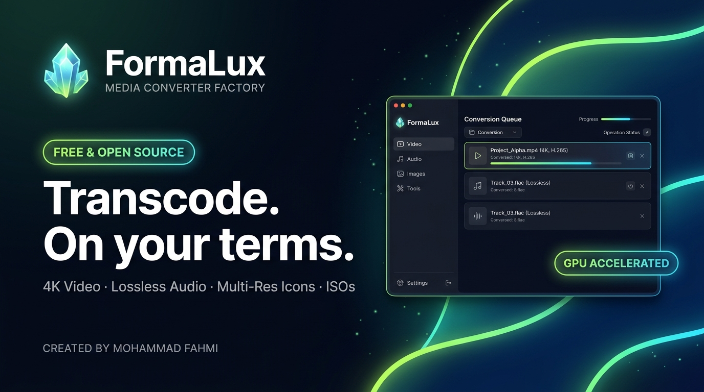
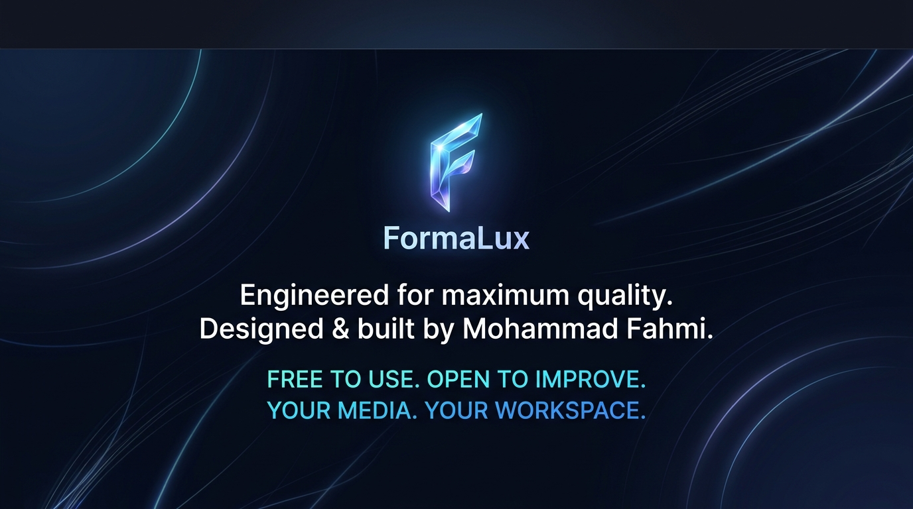

  

<!-- ACTION CTA BUTTONS -->

&nbsp;&nbsp;

&nbsp;&nbsp;

  

<!-- QUICK NAVIGATION -->
**[Explore Tools](#01--see-formalux-in-motion)** &nbsp;•&nbsp; 
**[GPU Acceleration](#-blazing-fast-hardware-acceleration)** &nbsp;•&nbsp; 
**[Subtitle Studio](#-subtitle-burning--advanced-styling)** &nbsp;•&nbsp; 
**[Download Edition](#02--pick-your-edition)** &nbsp;•&nbsp; 
**[Report an Issue](https://github.com/mohammadfahmi2030/FormaLux/issues)**

 

<!-- BADGES BAR -->

 

**Free to use. Open to improve. Built around your workflow.**

---

 

## ` 01 ` &nbsp; See FormaLux in motion ➔
> **FAST & PRECISION MEDIA ENGINE · REAL HARDWARE ACCELERATION**

### Find it. Convert it. Make it yours.

<table>
<tr>
<td width="33%" valign="top">

### 🌐 `01 / CONVERT`
#### One app. Every media format.
Batch convert 4K videos, remaster audio, resize graphics, convert documents, and rip optical discs. Any container, any modern codec.

</td>
<td width="33%" valign="top">

### 🎨 `02 / CONTROL`
#### Your rules. Studio quality.
Hardcode Arabic and multi-language subtitles with custom fonts and shadows, boost audio levels up to 400%, and brand with watermarks.

</td>
<td width="33%" valign="top">

### ⚡ `03 / ACCELERATE`
#### Keep your workflow moving.
Unlock blazing speeds with native **NVIDIA NVENC, Intel QuickSync, and AMD AMF** GPU hardware transcoding.

</td>
</tr>
</table>

 

**Transcode** video files (`MP4, MKV, WebM, AVI, MOV, TS, GIF`) with frame-perfect precision. **Remaster and boost** audio (`MP3, FLAC, WAV, AAC, M4A, OGG`) with peak limiters, noise reduction, and reverb filters. **Generate** multi-layer high-fidelity Windows icon files (`.ico`) from `16x16` up to `256x256`. **Rip & Burn** DVD/CD discs and create ISO/CSO images.

---

### 🎬 Subtitle Burning & Advanced Styling
FormaLux eliminates subtitle rendering issues once and for all:
* **Interactive Color & Styling Studio:** Pick primary text color, outline border color, thickness, and dropshadow blur.
* **Full Arabic Script Support:** Native support for both **UTF-8** and **ANSI Windows-1256**, ensuring Arabic characters render connected, flawlessly shaped, and without encoding glitches.
* **Accurate Audio Boost:** Need quiet video dialogue louder? Apply up to **+400% volume amplification** with built-in dynamic compressor protection.

---

### ⚡ Blazing-Fast Hardware Acceleration
FormaLux auto-detects your workstation’s GPU hardware:
* **NVIDIA GeForce / RTX:** `h264_nvenc` & `hevc_nvenc`
* **Intel Iris / Arc / UHD:** `h264_qsv` & `hevc_qsv`
* **AMD Radeon:** `h264_amf` & `hevc_amf`

> [!TIP]
> Hardware encoding reduces video export times by up to **80%** while keeping your CPU free for other tasks.

 

---

## ` 02 ` &nbsp; Pick your Edition ➔
> **ONE COMPLETE TOOLKIT · STANDALONE & OFFLINE**

### Complete · The Official Windows Edition
Everything bundled in one seamless, self-contained desktop package.

| Detail | Specification |
| :--- | :--- |
| **Package** | `FormaLux-Setup.exe` (Official Installer & Uninstaller) |
| **Download Size** | **~659 MB** (Fully offline — includes all codecs, FFmpeg binaries, and runtimes) |
| **Compatibility** | Windows 11 / Windows 10 (64-bit) |
| **Updates** | Automatic in-app check via GitHub Releases |
| **Digital Signature** | Built with local publisher signing & integrity validation |

 

&nbsp;&nbsp;

 

> [!NOTE]
> **Updating an existing installation?** Simply download and run the latest `FormaLux-Setup.exe`. It will cleanly upgrade your installed copy while preserving all your saved preferences and custom conversion presets.

 

---

## ` 03 ` &nbsp; A Workspace That Feels Like You ➔
> **LIGHT · DARK · FIVE CURATED ACCENT PALETTES**

### See it move. Stay in control.

FormaLux is built to be enjoyable every single day:
* **Five Curated Visual Themes:**
  * 🌌 **Dark Obsidian** (Default sleek night mode)
  * 🌊 **Deep Navy** (Crisp corporate contrast)
  * 🔮 **Royal Purple** (Vibrant creative workspace)
  * 🌿 **Emerald Green** (Calm high-focus aesthetic)
  * ☀️ **Clean Light** (Daylight readability)
* **True RTL & Multi-Language Support:** First-class right-to-left layout for **العربية (Arabic)**, alongside English, Français, Español, and Türkçe.
* **Windows Context Menu:** Right-click any video, audio, or picture file anywhere on your PC to immediately launch FormaLux conversion.
* **System Tray Control:** Minimize background batch jobs directly to the Windows taskbar tray beside the system clock.

 

---

## ` 04 ` &nbsp; Built in the Open ➔
> **MIT SOURCE · CLEAR DOCS · COMMUNITY CONTRIBUTIONS**

FormaLux is an independent, free and open-source project created and actively maintained by **Mohammad Fahmi**. The original source code is **MIT licensed**; all bundled tools retain their respective open-source licenses.

 

<table>
<tr>
<th width="50%">🔍 Explore</th>
<th width="50%">🛠️ Build & Contribute</th>
</tr>
<tr>
<td valign="top">

* 📖 [Bilingual README (عربي / English)](README.md)
* 📋 [Release Changelog & Notes](https://github.com/mohammadfahmi2030/FormaLux/releases)
* 🛡️ [License Terms (MIT)](LICENSE)
* 🎬 Supported Codecs & Containers

</td>
<td valign="top">

* 💻 [Clone Repository (`git clone`)](https://github.com/mohammadfahmi2030/FormaLux.git)
* 🐛 [Report a Bug](https://github.com/mohammadfahmi2030/FormaLux/issues)
* 💡 [Suggest a Feature](https://github.com/mohammadfahmi2030/FormaLux/issues)
* 📦 [Source ZIP Archive](https://github.com/mohammadfahmi2030/FormaLux/archive/refs/heads/main.zip)

</td>
</tr>
</table>

 

<b>▶ Compatibility, validation and system specifications</b>

 

* **Operating System:** Windows 10 (Build 19041+) or Windows 11 64-bit.
* **Processor (CPU):** Intel Core i3 / AMD Ryzen 3 or higher (Multi-core recommended for CPU encoding).
* **Memory (RAM):** 4 GB RAM minimum (8 GB+ recommended for 4K video transcoding).
* **Graphics (GPU):** NVIDIA GeForce GTX 900+ / Intel HD Graphics 500+ / AMD Radeon RX 400+ for hardware acceleration.
* **Storage:** 1.5 GB free disk space for application and temporary conversion cache.
* **Internet Connection:** Not required! FormaLux runs 100% offline. Internet is only used when you explicitly click *Check for Updates*.

  

<!-- FOOTER CARD BANNER -->

  

[GitHub](https://github.com/mohammadfahmi2030/FormaLux) &nbsp;•&nbsp; 
[Releases](https://github.com/mohammadfahmi2030/FormaLux/releases) &nbsp;•&nbsp; 
[MIT License](LICENSE)

 

**FormaLux — Copyright © 2026 Mohammad Fahmi. All rights reserved.**

