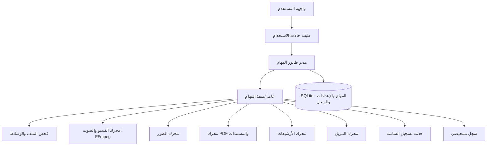

# خطة هندسة عكسية وإنشاء برنامج مشابه لـ Format Factory

> **الهدف:** تحليل ملف `FFSetup5.21.0.0.exe` المتاح، ثم وضع خطة عملية لبناء تطبيق مستقل يؤدي وظائف شبيهة بـ Format Factory.  
> **تاريخ إعداد الخطة:** 23 أكتوبر 2026.  
> **النطاق المرجعي:** Format Factory 5.21.0.0، مع الإشارة إلى الإصدارات اللاحقة حيث يلزم.  
> **مهم:** هذه الوثيقة خطة إعادة تنفيذ مستقلة وليست ادعاءً باستعادة الشيفرة المصدرية الأصلية.

---

## 1. الملخص التنفيذي

الملف المرفوع هو مُثبّت Format Factory 5.21.0.0 من شركة Free Time. يكشف الفحص الساكن عن غلاف تثبيت Windows وموارد إصدار وتوقيع رقمي، لكنه لا يكفي وحده لاستعادة مصدر التطبيق أو إثبات تفاصيل كل خوارزمية داخلية. لذلك، فالنهج الواقعي هو **تحليل السلوك والواجهات والميزات المعلنة، ثم بناء تطبيق جديد بمعمارية واضحة ومحركات معالجة موثوقة** بدل محاولة إعادة إنتاج الشيفرة الأصلية حرفيًا.

يُعلن المنتج عن تحويل الفيديو والصوت والصور، وقص الملفات ودمجها وتقسيمها ومزجها، وأدوات PDF والمستندات، وفك ضغط ZIP/RAR/7z، وتسجيل الشاشة، والتنزيل من مواقع الفيديو، ونسخ الوسائط من بعض الأقراص. كما تسجل ملاحظات الإصدار 5.21 استبدال محرك تنزيل الفيديو بـ `yt-dlp` وإصلاح مشكلة في إعادة تسمية الملفات على دفعات وبعض الأخطاء الأخرى. [الموقع الرسمي للمنتج](https://www.pcfreetime.com/formatfactory/index.php/en/aboutus.php?language=en) · [سجل التغييرات الرسمي](https://www.pcfreetime.com/formatfactory/changelog.php?language=en)

**التوصية:** بناء تطبيق Windows مستقل بواجهة عربية/إنجليزية، وطابور مهام موحد، ومحرك وسائط يستند إلى FFmpeg، مع إضافة الوظائف تدريجيًا. ابدأ بنواة التحويل والطابور وسجل الأخطاء، ثم وسّع التطبيق إلى الصور والمستندات والتسجيل والتنزيل والأقراص.

## 2. ما تم التحقق منه في الملف المرفوع

### 2.1 معلومات الملف

| البند | نتيجة الفحص |
|---|---|
| الاسم | `FFSetup5.21.0.0.exe` |
| الحجم الدقيق | 138,197,912 بايت (نحو 131.8 MiB أو 138.2 MB عشريًا) |
| SHA-256 | `0ac98b4b633924829889efc759b865865c0f811b9a38a563d8073b1ac8229aa3` |
| MD5 | `d8b191acc220e12f67cf35df943bd428` |
| النوع التنفيذي | Windows PE32، معمارية Intel i386، واجهة رسومية |
| عدد أقسام PE | 6 |
| الطابع الزمني الموجود في رأس PE | 23 يناير 2024، 16:35:17 بحسب أداة الفحص |
| معلومات المنتج داخل موارد الإصدار | `Format Factory`، ووصف الملف `Format Factory Installer`، والاسم الداخلي `FFSetup5.21.0.0` |
| ناشر شهادة التوقيع المدرجة | `Free Time Software Technology Co., Ltd.` |
| جهة إصدار الشهادة | DigiCert Trusted G4 Code Signing RSA4096 SHA384 2021 CA1 |
| إطار التثبيت المرجح | توجد سلاسل مثل `Caphyon.AI.ExtUI` و`Advanced Installer`؛ وهذا مؤشر قوي على استخدام Advanced Installer |

تطابق بصمة MD5 وSHA-256 الناتجة محليًا مع البصمات المنشورة لهذا اسم الملف يدعم التعرف عليه، لكنه **لا يغني عن التحقق من التوقيع وسلسلة الثقة وإلغائها على نظام موثوق** عند تقرير تشغيل الملف.

### 2.2 ما تعنيه هذه النتائج

- الملف التنفيذي الظاهر هو **مُثبّت/Bootstrapper**، وليس مشروعًا مصدرّيًا يمكن فتحه مباشرة في Visual Studio أو تفكيكه إلى ملفات المصدر الأصلية.
- يحتوي الملف على موارد PE قياسية، ومنها موارد إصدار وأيقونات وموارد واجهة.
- توجد بيانات كبيرة مضافة بعد أقسام PE، وهو نمط متوافق مع وجود محتويات تثبيت مضمّنة. لم يتم استخراج كل الحزمة الداخلية أو التحقق من قائمة الملفات المضمّنة.
- عُثر على مؤشرات إلى وظائف تثبيت وملفات وعمليات Windows في سلاسل الملف. وجود سلسلة نصية أو اسم دالة وحده لا يثبت أن وظيفة معينة تُنفّذ بالفعل في كل مسار تشغيل.

### 2.3 حدود الفحص

هذا الفحص **ساكن فقط**: لم يتم تشغيل المُثبّت، ولم يتم تثبيت البرنامج، ولم يتم تشغيل التطبيق في نظام حي. ولم يتم استرجاع الشيفرة المصدرية الأصلية أو إجراء تحليل ديناميكي في آلة افتراضية. لذلك تُعامل تفاصيل التنفيذ الداخلي، واختيار المكتبات لكل وظيفة، وتسلسل العمليات داخل البرنامج باعتبارها أسئلة تحتاج إلى فحص إضافي، لا حقائق مؤكدة.

## 3. نطاق الميزات المطلوب إعادة تنفيذها

ينبغي فصل الميزات المعلنة عن الميزات التي يمكن تنفيذها في الإصدار الأول. ليست كل الوظائف متساوية في صعوبة التنفيذ أو مستوى الدقة المطلوب.

| المجال | الوظائف المستهدفة | الأولوية | ملاحظات تنفيذية |
|---|---|---:|---|
| الفيديو | تحويل الصيغ، إعدادات الجودة والدقة، قص، دمج، تقسيم، mux/remux، قص الإطار، تدوير، علامة مائية/إزالة شعار حيث يكون ذلك مشروعًا، ترجمة | P0 | أساسه FFmpeg/ffprobe؛ يجب إظهار خيارات الترميز بوضوح |
| الصوت | تحويل الصيغ، قص، دمج، تقسيم، مزج، ضبط مستوى الصوت | P0 | وظائف كثيرة يمكن بناؤها كسلاسل FFmpeg قابلة للاختبار |
| الصور | تحويل الصور، تغيير المقاس، التدوير/القلب، التعامل مع WebP وHEIC، بيانات وصفية أساسية | P0 | استخدام مكتبة صور تدعم التراخيص والصيغ المطلوبة |
| طابور المهام | إضافة ملفات ومجلدات، ترتيب، حذف، بدء/إيقاف/إلغاء، تقدم، سجل النتائج، إعادة المحاولة | P0 | مكوّن مركزي مشترك لكل أنواع المهام |
| ملفات PDF | دمج/تقسيم PDF، استخراج النص والصور، تحويل إلى نص أو صور، OCR اختياري | P1 | تحويل PDF إلى DOC/XLS مع الحفاظ على التخطيط تحدٍ منفصل ويحتاج اختبارات مخصصة |
| المستندات | PDF إلى صيغ نصية/مكتبية والعكس في حدود المكتبات المختارة | P1 | يجب التمييز بين استخراج النص وإعادة بناء التخطيط الأصلي |
| الأرشيفات | فتح/استخراج ZIP و7z وRAR إن سمحت المكتبات وشروطها | P1 | لا تُضمّن مكتبات دون مراجعة شروط التوزيع؛ دعم الاستخراج لا يعني دعم إنشاء كل صيغة |
| تسجيل الشاشة | تسجيل شاشة/نافذة/منطقة مع صوت النظام والميكروفون، اختيار معدل الإطارات | P1 | ربط التقاط Windows بمشفّر FFmpeg، ومراعاة أذونات التسجيل |
| تنزيل الفيديو | إدخال رابط، اكتشاف الصيغ المتاحة، تحديد الجودة والمسار، إظهار التقدم | P2 | استخدام `yt-dlp` وفق شروط المواقع وحقوق المحتوى، دون تجاوز DRM أو ضوابط الوصول |
| الأقراص | قراءة/استخراج محتوى أقراص يملك المستخدم حق استخدامها، واستخراج الصوت من CD حيث تدعمه الأجهزة | P2 | تجنّب تجاوز الحماية أو نسخ مواد محمية خلافًا للقانون |
| لغات وواجهات | العربية والإنجليزية أولًا، RTL، قوالب تحويل جاهزة | P0 | توحيد النصوص في موارد ترجمة وعدم تثبيتها داخل الشيفرة |
| إصلاح الملفات | تشخيص بعض حالات تلف الوسائط ومحاولة إعادة تغليف/إعادة ترميزها | P3 | لا ينبغي الوعد بإصلاح كل ملف تالف؛ تحديد نطاق الحالات القابلة للمعالجة |

**P0** يعني الحد الأدنى القابل للإطلاق، و**P1** توسعة مهمة بعد ثبات النواة، و**P2/P3** مراحل لاحقة.

## 4. المتطلبات غير الوظيفية

1. **الاعتمادية:** فشل تحويل ملف واحد لا يوقف بقية الطابور.
2. **السلامة:** عدم استبدال ملف مصدر بالخطأ؛ الكتابة إلى ملف مؤقت ثم نقله إلى المسار النهائي عند نجاح المهمة.
3. **الأداء:** تقدم حقيقي مبني على بيانات المحرك، وتحديد متزامن للمهام لتجنب استهلاك المعالج والذاكرة بصورة مفرطة.
4. **قابلية الصيانة:** فصل الواجهة عن محركات التحويل؛ لكل نوع مهمة مدخلات ومخرجات وأخطاء موحدة.
5. **الخصوصية:** التحويل المحلي يعمل دون اتصال بالإنترنت، باستثناء الوظائف التي تحتاج الشبكة مثل تنزيل المحتوى أو فحص التحديثات.
6. **إمكانية الوصول:** دعم لوحة المفاتيح، تكبير الواجهة، أسماء مفهومة لعناصر التحكم، ورسائل أخطاء قابلة للقراءة بقارئات الشاشة.
7. **تدويل الواجهة:** اتجاه RTL للنص العربي مع عدم قلب مسارات الملفات أو سلاسل الأوامر أو أرقام الإصدارات.
8. **قابلية التحديث:** إصدار واضح لكل وحدة، والتحقق من توقيع التحديثات قبل تثبيتها.

## 5. معمارية مقترحة

### 5.1 المكدس التقني

**خيار مرجعي عملي لتطبيق Windows:**

- **الواجهة:** C# مع WPF أو WinUI، باستخدام نسخة .NET مدعومة طويل الأجل عند بدء المشروع.
- **إدارة المهام:** `Task` و`CancellationToken` أو ما يعادلها، مع حد أقصى للتوازي وإلغاء آمن للعمليات الفرعية.
- **محرك الفيديو والصوت:** `FFmpeg` و`ffprobe` كعمليات فرعية مستقلة؛ يمكن لاحقًا ربط مكتبات FFmpeg مباشرة إذا كانت هناك حاجة واضحة.
- **الصور:** مكتبة مثل ImageMagick أو libvips أو واجهة .NET موثوقة تدعم مجموعة الصيغ المطلوبة.
- **PDF:** محرك عرض/استخراج مناسب مع مراجعة الترخيص، والاستعانة بأداة OCR عند الحاجة.
- **الأرشيفات:** مكتبة مثل libarchive أو أداة مناسبة مع تدقيق التراخيص والصيغ المدعومة.
- **تنزيل الفيديو:** تشغيل `yt-dlp` كأداة منفصلة قابلة للتحديث، مع تمرير الخيارات عبر قائمة معاملات آمنة.
- **التسجيل:** واجهات Windows لالتقاط الشاشة والصوت، ثم تمرير الإطارات والصوت إلى مسار الترميز.
- **الإعدادات والسجل:** SQLite للمهام وسجل النتائج، وملفات إعدادات محدودة للإعدادات العامة وملفات التعريف.
- **التثبيت:** WiX أو MSIX أو مُثبّت موثوق آخر، مع توقيع رقمي وإلغاء تثبيت نظيف.

هذه توصية تصميمية وليست استنتاجًا بأن Format Factory نفسه مكتوب بهذه التقنيات. اختيار الإطار النهائي يعتمد على خبرة الفريق، والتراخيص، واحتياجات الأداء والتوزيع.

### 5.2 مخطط عالي المستوى



### 5.3 قواعد التصميم الأساسية

- لكل مهمة نوع صريح، ومدخلات، وملف تعريف للمخرجات، ومسار مؤقت، وحالة، ونسبة تقدم، ونتيجة.
- لا تستقبل طبقة الواجهة أوامر نظام اعتباطية من المستخدم. تُحوّل الخيارات إلى معاملات محددة ومتحقق منها.
- يجب تمرير معاملات العمليات الفرعية كعناصر منفصلة لا بتركيب سلسلة shell؛ في .NET يُفضّل استخدام `ProcessStartInfo.ArgumentList`.
- استخدم `ffprobe` أولًا لتحديد الحاوية والترميزات والمدة والدقة والمسارات الصوتية والترجمات الموجودة.
- حدّد آلة حالات لكل مهمة مثل: `Queued`، `Validating`، `Running`، `Finalizing`، `Completed`، `Failed`، `Cancelled`.
- اكتب السجل على نحو يشرح الخطأ للمستخدم، مع الاحتفاظ بتفاصيل فنية قابلة للتصدير دون تضمين أسرار أو بيانات غير ضرورية.

## 6. الوحدات المطلوب بناؤها بالتفصيل

### 6.1 النواة وطابور المهام

**الوظائف:** إضافة الملفات بالسحب والإفلات، إضافة مجلدات، كشف التكرار عند الحاجة، ترتيب المهام، إيقاف/استئناف/إلغاء، إعادة المحاولة، فتح مجلد الإخراج، تصدير سجل الأخطاء.

**متطلبات التنفيذ:**
- خدمة `JobQueue` مسؤولة عن حالات المهام وحدّ التوازي.
- واجهة `IJobHandler` موحدة؛ ينفّذ كل مكوّن نوعًا واحدًا أو أكثر من المهام.
- حفظ المهام عند إغلاق التطبيق بصورة طبيعية، واستعادة المهام غير المكتملة بوضع آمن بعد إعادة التشغيل.
- فحص صلاحيات القراءة والكتابة والمساحة الحرة قبل بدء المعالجة.
- لا تُعتبر المهمة ناجحة إلا بعد التحقق من وجود الملف النهائي وإمكانية قراءته الأساسية.

**معيار القبول:** يمكن وضع عشرات الملفات في الطابور، وتظل الواجهة مستجيبة، ويؤدي فشل ملف إلى تسجيله والانتقال إلى التالي، ولا تُترك ملفات نهائية جزئية باسمها النهائي.

### 6.2 تحويل الفيديو والصوت

**خطوات التنفيذ:**
1. بناء طبقة استدعاء لـ`ffprobe` تنتج نموذجًا موحدًا لمعلومات الوسائط.
2. تصميم ملفات تعريف جاهزة مثل MP4/H.264، وMKV، وMP3، وAAC، وWAV، وFLAC، مع إظهار الصيغ والترميزات المتاحة فعليًا في المحرك.
3. بناء مولّد معاملات FFmpeg من نموذج خيارات typed بدل تجميع النصوص يدويًا في كل شاشة.
4. دعم القص بمدة أو نطاق زمني، وتحديد الدقة ومعدل الإطارات ومعدل البت، واختيار المسارات الصوتية والترجمات.
5. إضافة الدمج والتقسيم وremux عندما تسمح الحاويات والترميزات بذلك دون إعادة ترميز غير ضرورية.
6. قراءة التقدم من مخرجات FFmpeg المهيكلة (`-progress`) بدل تقدير النسبة من الزمن المنقضي فقط.
7. إضافة كشف للمساحة المتاحة، وسياسة تسمية ملفات لا تستبدل المخرجات القديمة دون تأكيد واضح.

**نقاط الجودة:** مقارنة مدة الملف الناتج، والتحقق من الصوت والصورة، واختبار أسماء الملفات العربية، والمسارات الطويلة، والملفات الكبيرة، والترميزات غير المدعومة، وانقطاع القرص.

### 6.3 تحويل الصور

- بناء نموذج خيارات مشترك لتحويل الصيغ وتغيير الأبعاد وجودة JPEG/WEBP، والتدوير والقلب.
- حفظ الشفافية عندما تكون صيغة الإخراج تدعمها، وعدم إسقاط بيانات EXIF دون خيار واضح للمستخدم.
- معالجة الصور متعددة الإطارات مثل GIF وTIFF وفق سلوك موثّق.
- إضافة تحويل HEIC/WebP فقط عند توافر الدعم في مكتبة التوزيع المختارة.
- إنشاء اختبارات مرئية لمقارنة الدقة والألوان والشفافية؛ بعض التحويلات ذات خسارة بطبيعتها ولا يمكن ضمان تطابق البكسلات.

### 6.4 PDF والمستندات

قسّم هذا المجال إلى وظائف منفصلة بدل التعامل معه كميزة واحدة:

1. **العمليات منخفضة المخاطر نسبيًا:** الدمج، التقسيم، تدوير الصفحات، استخراج الصور، وتحويل الصفحات إلى صور.
2. **استخراج المحتوى:** استخراج النص وترتيب الصفحات، مع التنبيه إلى أن ملفات PDF المصوّرة تحتاج OCR.
3. **التحويل المكتبي:** PDF إلى DOCX/XLSX/HTML أو صيغ مشابهة. الحفاظ على التخطيط والجداول في هذا النوع من التحويل ليس مضمونًا ويجب قياسه على ملفات اختبار حقيقية.
4. **OCR:** وحدة مستقلة قابلة للتفعيل، مع دعم العربية والإنجليزية والتحقق من جودة النص المستخرج.

**معيار القبول:** عدم فقد الصفحات بصمت، وتسجيل الصفحات التي لم يمكن تحويلها، وإظهار أن التحويل تقريبي عندما يتعذر الحفاظ على التنسيق الأصلي.

### 6.5 الأرشيفات

- دعم قائمة الصيغ التي تسمح بها المكتبة المختارة وشروط توزيعها.
- عرض محتوى الأرشيف قبل الاستخراج، مع دعم اختيار الملفات والمسار الوجهة.
- الحماية من Zip Slip ومسارات `..` والمسارات المطلقة والروابط الرمزية الخبيثة.
- وضع حدود اختيارية للحجم الكلي وعدد الملفات لتقليل خطر ملفات القنابل المضغوطة.
- لا تستخدم عبارة «يدعم RAR» بصورة مطلقة قبل تحديد الإصدار، وعمليات القراءة/الكتابة، والترخيص.

### 6.6 تنزيل الفيديو عبر الإنترنت

- حقل رابط واضح، وفحص صيغة الرابط، ثم عرض العناوين والجودات والصيغ التي تعيدها الأداة.
- فصل تنزيل الوسائط عن دمجها أو تحويلها، إذ قد تتوافر مسارات صوت وصورة منفصلة.
- عرض سبب الفشل القادم من الأداة للمستخدم بلغة مفهومة، مع خيار تصدير السجل.
- جعل تحديث `yt-dlp` وحدة مستقلة ومتحققًا من مصدرها وتوقيع/بصمة الحزمة حسب آلية التوزيع.
- احترام شروط الخدمة وحقوق النشر. لا يُصمّم المكوّن لتجاوز DRM أو تسجيل الدخول غير المصرح به أو القيود التقنية المفروضة لحماية المحتوى.

### 6.7 تسجيل الشاشة والصوت

- خيارات المصدر: الشاشة كلها، نافذة، أو منطقة مستطيلة متى سمحت واجهات Windows بذلك.
- اختيار معدل الإطارات، والدقة، وترميز الفيديو، ومصدر الصوت النظامي والميكروفون.
- إظهار حالة التسجيل بوضوح وتوفير زر إيقاف يمكن الوصول إليه حتى عند الانتقال بين النوافذ.
- التعامل مع أذونات النظام والأجهزة غير المتاحة ومزامنة الصوت والصورة.
- حفظ التسجيل في ملف مؤقت؛ لا يُعتمد الملف النهائي إلا عند إغلاق الحاوية بصورة صحيحة.

### 6.8 الأقراص الضوئية

أضف هذه الوحدة بعد استقرار التحويل الأساسي، إذ تعتمد على وجود محرك فعلي وتختلف نتائجها حسب نوع القرص ونظام الملفات والترميزات. اجعل الدعم منصبًا على الأقراص والمواد التي يملك المستخدم حق نسخها. لا تضف طرقًا لتجاوز أنظمة الحماية أو القيود القانونية.

## 7. تصميم الواجهة

### 7.1 الشاشات الرئيسية

- **الرئيسية/الطابور:** جميع المهام وحالاتها، ونسبة التقدم، والوقت التقريبي عندما يمكن تقديره، ومسار المخرجات.
- **تحويل الفيديو:** الملفات المصدرية، ملف التعريف، إعدادات متقدمة ضمن لوحة منفصلة.
- **تحويل الصوت.**
- **تحويل الصور.**
- **PDF والمستندات.**
- **الأرشيفات.**
- **تنزيل الفيديو.**
- **تسجيل الشاشة.**
- **إعدادات عامة:** مسار الإخراج، عدد المهام المتوازية، لغة الواجهة، أدوات الترميز، السجل والتحديثات.

### 7.2 مبادئ تجربة المستخدم

- اجعل الملفات المصدرية والإخراج المتوقع واضحين قبل بدء المهمة.
- استخدم إعدادات جاهزة للمستخدم العادي وإعدادات متقدمة للمستخدم الخبير.
- لا تعرض خيارات لا يدعمها المحرك أو النظام الحالي.
- رسائل الخطأ باللغة العربية يجب أن تذكر الإجراء المقترح، مع رمز الخطأ أو مقتطف تشخيصي اختياري.
- ادعم السحب والإفلات والاختصارات ولوحة المفاتيح، وتأكد من صحة RTL في الجداول والنوافذ المنبثقة.

## 8. نموذج البيانات المقترح

يمكن أن تبدأ قاعدة SQLite بالجداول التالية:

- `Jobs`: المعرّف، نوع المهمة، الحالة، تاريخ الإنشاء، تاريخ البدء والانتهاء، النسبة، رسالة الحالة.
- `JobInputs`: ملفات المصدر، ترتيبها، الحجم، البصمة الاختيارية، بيانات الوسائط المكتشفة.
- `JobOptions`: نوع الإخراج، ملف التعريف، الخيارات المعتمدة، إصدار المحرك.
- `JobOutputs`: المسار المؤقت والنهائي، الحجم، الحالة، بيانات التحقق.
- `JobLogs`: المستوى، الوقت، مصدر الرسالة، النص المنقح من البيانات الحساسة.
- `Profiles`: اسم ملف التعريف، نوع الوسائط، إعدادات الترميز، إصدار المخطط.
- `AppSettings`: اللغة، مسار الإخراج، التوازي، سياسات الاستبدال والسجل.

تُخزّن الخيارات ذات البنية المعقدة في JSON داخل قاعدة البيانات أو مخطط منفصل مع `schemaVersion`، وتُجرى ترقية للمخطط عند إصدار تحديث جديد.

## 9. هيكل مشروع مبدئي

```text
MediaSuite/
├─ src/
│  ├─ MediaSuite.App/              # واجهة WPF/WinUI
│  ├─ MediaSuite.Application/      # حالات الاستخدام والخدمات
│  ├─ MediaSuite.Domain/           # أنواع المهام والحالات والقواعد
│  ├─ MediaSuite.Infrastructure/   # التخزين والسجل والعمليات الفرعية
│  ├─ MediaSuite.Engine.FFmpeg/    # ffmpeg/ffprobe ومخططات التحويل
│  ├─ MediaSuite.Engine.Images/    # عمليات الصور
│  ├─ MediaSuite.Engine.Documents/ # PDF والمستندات وOCR
│  ├─ MediaSuite.Engine.Archives/  # الأرشيفات
│  ├─ MediaSuite.Engine.Download/  # yt-dlp
│  └─ MediaSuite.Engine.Capture/   # التقاط الشاشة والصوت
├─ tests/
│  ├─ MediaSuite.UnitTests/
│  ├─ MediaSuite.IntegrationTests/
│  ├─ MediaSuite.MediaFixtures/
│  └─ MediaSuite.UITests/
├─ packaging/                      # المُثبّت والتوقيع والتحديث
├─ docs/                           # قرارات التصميم وتراخيص المكونات
└─ tools/                           # أدوات التطوير والتحقق فقط
```

## 10. خطة تنفيذ مرحلية

التقدير التالي يفترض فريقًا صغيرًا لديه خبرة في تطبيقات Windows ومعالجة الوسائط. المدة الفعلية تتغير وفق حجم الفريق والدقة المطلوبة. الوصول إلى نطاق قريب من كل ميزات المنتج الناضج قد يستغرق عدة أشهر إضافية.

| المرحلة | المدة التقريبية | المخرجات | شرط الانتقال |
|---|---:|---|---|
| 0. تعريف النطاق والمخاطر | أسبوع | قائمة ميزات، قرار التقنية، قائمة تراخيص، حالات استخدام، نماذج واجهة أولية | اعتماد نسخة MVP بوضوح |
| 1. النواة وطابور المهام | أسبوعان | إضافة ملفات، حالات المهام، سجل، إلغاء، إعدادات ومسارات | اختبارات الطابور واستجابة الواجهة ناجحة |
| 2. التحويل الأساسي | 3 أسابيع | Video/Audio عبر FFmpeg، ملفات تعريف، تقدم حقيقي | نجاح مجموعة ملفات الاختبار بلا تلف صامت |
| 3. الصور والتجميع الدفعي | أسبوعان | تحويل صور، تغيير أبعاد، إعادة تسمية آمنة، معالجة مجلدات | اختبارات الصور والملفات العربية ناجحة |
| 4. التثبيت والتحديثات الأولية | أسبوع | مُثبّت نظيف، إزالة تثبيت، توقيع، فحص إصدارات الأدوات | التثبيت والترقية والإزالة ناجحة على جهاز نظيف |
| 5. PDF والمستندات | 2–4 أسابيع | دمج وتقسيم واستخراج وتحويل أولي | تقرير جودة على مجموعة PDFs متنوعة |
| 6. التسجيل والأرشيفات | 2–4 أسابيع | تسجيل الشاشة/الصوت واستخراج الأرشيفات | اختبارات الأجهزة والمسارات والأرشيفات الآمنة |
| 7. تنزيل الفيديو | 1–2 أسبوع | واجهة تنزيل، كشف الجودات، تحديث الأداة، رسائل أخطاء | تنزيل حالات اختبار مصرح بها، وفشل آمن للحالات الأخرى |
| 8. التحسين والإطلاق | 2–3 أسابيع | تحسين الأداء، الترجمة، التوثيق، توقيع وبناء نهائي | اجتياز بوابة الجودة والإصدار |

**الاقتراح التنفيذي:** إصدار MVP في نهاية المرحلة 4، ثم إصدار توسعة كلما استقرت وحدة جديدة. لا تؤخّر إطلاق النواة حتى يكتمل كل شيء.

## 11. خطة الاختبارات ومعايير القبول

### 11.1 اختبارات وظيفية

- تحويل فيديو قصير بين حاويات وترميزات مختلفة، مع صوت وبدونه.
- استخراج الصوت من الفيديو، وتحويل WAV/MP3/AAC حسب الدعم المتاح.
- قص ملف عند بداية/نهاية صحيحتين، ودمج مقاطع متوافقة، وتقسيم ملف طويل.
- تحويل PNG/JPEG/WebP/HEIC وفق الدعم الفعلي مع اختبار الشفافية والأبعاد.
- دمج PDF واستخراج نص من PDF نصي ومن PDF مصوّر مع توضيح احتياج OCR.
- اختبار الأرشيفات السليمة والتالفة والأرشيفات ذات المسارات الضارة.
- إلغاء مهمة وسط التحويل والتحقق من عدم بقاء ملف نهائي ناقص.

### 11.2 اختبارات الاعتمادية والأداء

- أسماء وامتدادات عربية، مسارات تحتوي مسافات ورموزًا، ومسارات طويلة.
- ملفات كبيرة جدًا مع اختبار مساحة القرص وذاكرة التطبيق.
- انقطاع قرص الإخراج، وعدم وجود صلاحيات، وامتلاء المساحة، وملف قيد الاستخدام.
- تشغيل عدة مهام متزامنة ضمن الحد المسموح، والتأكد من عدم تجمد الواجهة.
- إغلاق التطبيق وإعادة تشغيله مع وجود مهام محفوظة.
- اختلاف عتاد GPU وعدم دعم الترميز العتادي؛ يجب الرجوع إلى البرمجة على CPU عندما يكون ذلك خيارًا صحيحًا.

### 11.3 اختبارات الأمان

- رفض أو تنقية مسارات غير صالحة ومسارات خروج من مجلد الاستخراج.
- عدم تمرير أسماء الملفات أو الروابط كسلاسل shell قابلة للتنفيذ.
- اختبار الملفات الواردة من الإنترنت داخل بيئة اختبار، وعدم افتراض سلامة الملفات لمجرد امتدادها.
- التحقق من سلامة التحديثات والتوقيعات قبل تثبيتها.
- تقليل بيانات السجل وتجنب كتابة كلمات المرور أو رموز الجلسات أو بيانات المصادقة.

### 11.4 بوابة جودة قبل الإصدار

لا يُنشر الإصدار حتى تتحقق الشروط التالية:

- لا توجد أخطاء حرجة مفتوحة.
- جميع عمليات التحويل تكتب إلى ملف مؤقت ثم تُنهي الملف النهائي بصورة سليمة.
- كل مهمة فاشلة لها سبب مفهوم وسجل تشخيصي قابل للتصدير.
- التثبيت والترقية والإزالة تعمل على بيئة Windows نظيفة مدعومة.
- قائمة المكونات الخارجية وإصداراتها وتراخيصها مرفقة مع البناء.
- الواجهة العربية قابلة للاستخدام مع RTL وملفات ذات أسماء عربية.

## 12. المخاطر والقرارات التي يجب حسمها مبكرًا

| الخطر | التأثير | المعالجة |
|---|---|---|
| كثرة الصيغ واختلاف الترميزات | صعوبة اختبار شامل | ابدأ بقائمة صيغ محددة وزدها بعد قياس الطلب |
| اختلاف ترخيص FFmpeg بين البنيات | مخاطرة توزيع قانونية | اختر بناءً مناسبًا، وراجع التبعيات وواجبات الإشعار/المصدر قبل النشر |
| صعوبة تحويل PDF إلى DOC/XLS مع الحفاظ على التخطيط | توقعات غير واقعية | افصل الاستخراج النصي عن التحويل التخطيطي، واعرض حدودًا واضحة |
| تغيّر مواقع الفيديو وواجهات التنزيل | تعطل بعض الروابط | تحديث موثوق للأداة، ورسائل مفهومة، واختبارات دورية |
| الترميز العتادي يختلف حسب الجهاز | نتائج مختلفة وأخطاء | فحص قدرات الجهاز وإتاحة الرجوع إلى CPU |
| الملفات الضارة أو التالفة | فقد بيانات أو مخاطر أمنية | عمليات فرعية محدودة، معاملات آمنة، ملفات مؤقتة، وحدود للحجم والموارد |
| محاولة نسخ التصميم أو الأصول التجارية حرفيًا | مخاطر قانونية وخلط في العلامة | استخدام اسم وهوية وأيقونات ونصوص أصلية، وعدم نسخ الشيفرة أو الموارد الخاصة |

## 13. الجوانب القانونية والتوزيع

- أنشئ تطبيقًا مستقلًا ولا تستخدم اسم Format Factory أو شعاره بما يوحي بوجود صلة رسمية.
- لا تنسخ موارد البرنامج أو نصوصه أو شيفرته الخاصة. استلهم الوظائف العامة ونفّذها بهندسة وواجهة وأصول أصلية.
- راجع تراخيص كل مكوّن ومكتبة، خصوصًا FFmpeg وبنيات الترميز ومكتبات PDF والأرشيفات. احتفظ بقائمة `ThirdPartyNotices` وإصدارات دقيقة للتبعيات.
- اجعل التثبيت شفافًا: اسم الناشر، ما سيتم تثبيته، المسارات، وآلية إزالة نظيفة. تجنّب تثبيت مكونات اختيارية دون موافقة صريحة.
- لا تضف تجاوز حماية DRM أو القيود التقنية، ولا تجعل أداة التنزيل تستهدف محتوى لا يملك المستخدم الإذن بتنزيله.
- وقّع ملفات التثبيت والتحديثات بشهادة مناسبة، واحتفظ بعملية بناء قابلة للتكرار قدر الإمكان.

## 14. ما يلزم لمواصلة الهندسة العكسية بصورة أدق

إذا كان المطلوب لاحقًا تقريرًا أعمق عن **الملفات التي يثبتها هذا الإصدار تحديدًا**، فالخطوات الآمنة التالية هي:

1. التحقق من التوقيع الرقمي وسلسلة الثقة وإلغاء الشهادة على جهاز Windows معزول ومحدّث.
2. تحليل موارد PE وقائمة الموارد والبيانات الملحقة بالمُثبّت بأدوات تحليل ملفات معروفة، دون تشغيل الملف على الجهاز الأساسي.
3. استخراج محتويات المُثبّت باستخدام طريقة متوافقة مع صيغة الحزمة إن أمكن، ثم إنشاء قائمة أسماء ملفات وأحجام وبصمات وإصدارات للمكتبات المضمّنة.
4. فحص ملفات DLL/EXE المستخرجة بشكل ساكن وتحديد أنواع الملفات والمكتبات والمحركات، دون افتراض وجود مصدر أصلي.
5. عند الحاجة إلى تحليل سلوكي، استخدام آلة افتراضية مؤقتة ذات لقطة استعادة، ومنع الوصول إلى بيانات المستخدم الحقيقية، ومراقبة تغييرات الملفات والسجل والعمليات والاتصالات.
6. مقارنة الملفات والسلوك مع صفحة الإصدار وسجل التغييرات الرسميين، مع توثيق أي اختلاف بين المُثبّت والنسخة المنشورة.

لا ينبغي استخدام «فك التجميع» وحده لتقرير وظيفة ميزة كاملة. قد يساعد التفكيك في كشف تعليمات الآلة والاستدعاءات، لكنه لا يعيد بالضرورة أسماء المتغيرات أو بنية المشروع الأصلية أو التعليقات أو منطق العمل عالي المستوى.

## 15. مراجع التحقق

1. [الموقع الرسمي لـ Format Factory – الميزات والإصدار المعروض](https://www.pcfreetime.com/formatfactory/index.php/en/aboutus.php?language=en)
2. [سجل التغييرات الرسمي لـ Format Factory](https://www.pcfreetime.com/formatfactory/changelog.php?language=en)
3. [الموقع الرسمي باللغة العربية](https://www.pcfreetime.com/formatfactory/index.php?language=ar)
4. [سجل طرف ثالث يذكر الاسم والبصمة والحجم للملف](https://formatfactory.en.lo4d.com/download) — مرجع مساعد لمطابقة البصمة، وليس بديلًا عن مصدر الناشر.

---

## القرار النهائي المقترح

ابدأ ببرنامج Windows ذي هوية مستقلة، يستخدم طابور مهام موحدًا وFFmpeg للتحويل الأساسي، ثم أضف الصور وPDF والأرشيفات، وبعد ذلك التسجيل والتنزيل وعمليات الأقراص. لا تجعل هدف المشروع استنساخ الشيفرة الخاصة للبرنامج الأصلي؛ اجعل الهدف تحقيق مجموعة وظائف محددة، قابلة للاختبار والتحديث، مع توثيق التراخيص والأمان وحدود كل تحويل.
